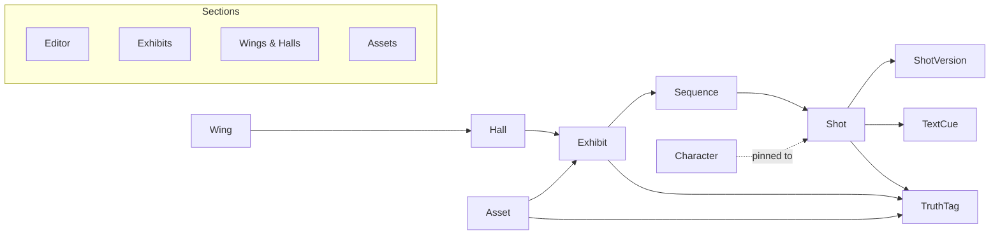

# Architecture

The workshop is the Museum of Time admin interface. The editor is the first section. Other sections share the same museum records and hang off one registry.

## Stack

Laravel 11 and NativePHP desktop. The UI is Livewire 3 with Alpine and a dark Tailwind wireframe. NativePHP's window provider is not registered during HTTP or tests, so those boots do not open a window.

SQLite is the database. The queue driver is `database`. ffmpeg and ffprobe render clips, burn text, and read durations. The default generator is local. Paid video APIs are not called.

## Sections

`config/sections.php` is the registry. Each entry names a key, label, module, route name, icon, placeholder flag, and Livewire component. `SectionServiceProvider` loads `app/Sections/<Module>/routes.php` for every entry and sets Livewire's class namespace to `App`, because the components live under `App\Sections` rather than `App\Livewire`.

| Section | Module | Route | Status |
| --- | --- | --- | --- |
| Editor | `Editor` | `/` | Timeline, inspector, characters, export |
| Exhibits | `Exhibits` | `/exhibits` | Placeholder |
| Wings & Halls | `Wings` | `/wings` | Placeholder |
| Assets | `Assets` | `/assets` | Media library |

To add a section: add a row to `config/sections.php`, create `app/Sections/<Module>/routes.php`, and add a Livewire component under `app/Sections/<Module>/Livewire` with the workshop layout. The left rail reads the registry. A placeholder can later be replaced by setting `placeholder` to false and swapping the component.

## Shared records

`Wing` contains `Hall`, and `Hall` contains `Exhibit`. Characters are global. An `Asset` belongs to an exhibit and carries a truth tag. `TruthTag` is `documented`, `legend`, or `invented`.

## Editor

A `Sequence` belongs to an exhibit. A `Shot` belongs to a sequence and keeps its own order, prompt, duration, model, frame, clip, and status. `ShotVersion` stores an earlier snapshot of that shot. `TextCue` rows (narration and plaque) belong to the shot, so they stay with it when shots are reordered. Cue time on the timeline is the sum of earlier shot durations plus the cue offset.

`AddScene` is the only creator of shots. The add-scene buttons, the artisan command, and pack approval all go through it. An empty frame cannot be rendered or exported.

## Providers

`VideoProvider` renders a clip from a start frame, an optional end frame, a prompt, and a duration. `VideoProviderManager` resolves the driver from `VIDEO_PROVIDER`.

| Driver | Behavior |
| --- | --- |
| `fake` | Default. Ken Burns and a crossfade through ffmpeg. No network. |
| `runway` | Stub. Off unless `RUNWAY_ENABLED` is set, and still throws without calling the network. |
| `kling` | Stub. Off unless `KLING_ENABLED` is set, and still throws without calling the network. |

A `VoiceProvider` for ElevenLabs is planned and is not in the tree. Narration is not synthesized. Narration text is written as `mov_text` subtitles. An audio-only cue stores the audio path and an empty text column, and it does not add a subtitle.

## Agent entry points

`php artisan workshop:add-scene` adds one shot and prints it as JSON. Placement is `--after-id` (a shot id) or `--after-order` (an order number). Omit both to append. Passing both is an error.

A scene pack is JSON, or a zip of that JSON plus frames. Each scene may set `after_id` or `after_order`, and must not set both. The old `after` field is rejected. `php artisan workshop:import-scenes` imports a JSON file immediately.

The editor's Import scenes button takes a `.zip` and copies it into the inbox. A `.json` or `.zip` dropped in `WORKSHOP_INBOX` (default `storage/app/inbox`) is listed the same way. Nothing from the inbox is added until it is approved. Reject leaves the sequence unchanged. Invalid JSON, a missing frame, or a frame path that leaves the pack is stored with the error and cannot be approved.

`php artisan workshop:import-exhibit <slug>` reads `museum-of-time/exhibits/<slug>/` and writes a pack into that same inbox. The first new scene uses `after_id` when the exhibit already has a last shot. Each later scene uses `after_order`. Approval creates the wing, hall, exhibit, and sequence when the pack includes a title and wing and the exhibit is not in the workshop yet.

## Export

The house standard is a 16:9 episode of 3–4 minutes (1280×720, 180–240 seconds) and 9:16 shorts of 45–60 seconds (720×1280). Shorts are packed from whole shots and never split a shot. A single shot longer than the cap becomes its own short, with a warning. Shorts are padded with `#0f1014`.

Each short is stamped `Museum of Time · {Wing} · {Exhibit} · Short N of M`. Plaque and stamp text are written to temp files under `storage/app/drawtext` and drawn with ffmpeg `drawtext` `textfile=` and `expansion=none`. Invented plaques are left off the burn-in. Narration text is a subtitle track. Audio-only narration cues are skipped.

## Media library

`MEDIA_ROOT` points at rendered files outside the repo, laid out like the archive: `exhibits/<slug>/`, `assets/<kind>/<slug>/`, and `previews/<slug>/`. The first use of the library links that folder at `storage/app/public/media` with `File::link` (a symlink, or a junction on Windows). A failed link is shown on the Assets page and does not stop boot.

Import matches a clip, frame, or narration file only inside the slug's own folders. No match means the shot stays draft and has no clip. Those paths are referenced, not copied. A failed pack import deletes only files that import itself copied, and leaves `MEDIA_ROOT` originals in place.

## Public repository

This tree is public. Do not commit personal hardware, device names, usernames, paths, tokens, or other personal information. API keys and local overrides belong in the gitignored `.env`. `.env.example` keeps placeholders only.
